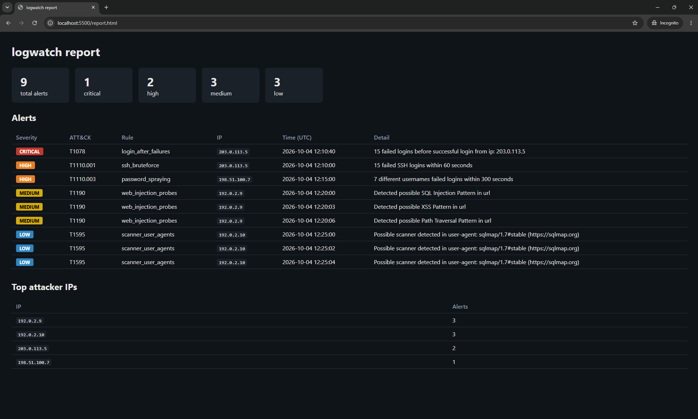

# logwatch


A small detection engine that reads SSH `auth.log` and nginx/Apache access logs,
flags common attacks, and maps each alert to MITRE ATT&CK.
Python only, no database, no frontend framework.



## Quickstart

```bash
git clone https://github.com/Hriitiik/logwatch && cd logwatch
pip install -e .
python -m logwatch --demo        # writes report.html + report.json
```

Or with Docker:

```bash
docker build -t logwatch .
mkdir -p out && chmod 777 out
docker run --rm -v "$PWD/out:/out" logwatch --demo --out /out/report.html --json /out/report.json
```

On your own logs:

```bash
python -m logwatch --auth /var/log/auth.log --web /var/log/nginx/access.log --fail-on high
```

`--fail-on <severity>` exits with code 1 if any alert is at or above that level, so CI can block on it.

## Detection rules

| Rule                   | Logic (defaults)                                         | Severity | ATT&CK    |
| ---------------------- | -------------------------------------------------------- | -------- | --------- |
| `ssh_bruteforce`       | ≥10 failed logins from one IP in 60s                     | high     | T1110.001 |
| `password_spraying`    | one IP failing against ≥5 distinct users in 300s         | high     | T1110.003 |
| `login_after_failures` | success from an IP with ≥5 failures in the previous 300s | critical | T1078     |
| `web_injection_probes` | SQLi / XSS / path traversal patterns in request URLs     | medium   | T1190     |
| `scanner_user_agents`  | sqlmap, nikto, nmap, gobuster in the user-agent          | low      | T1595     |

Each rule fires once per source IP, so one attacker produces one alert per rule.

## How it works

```
auth.log / access.log -> parsers -> events -> rules -> alerts -> engine -> terminal + JSON + HTML
```

- `parsers.py`: log text to uniform event dicts (UTC timestamps, URL-decoded paths)
- `rules.py`: pure functions, events in and alerts out, no I/O
- `engine.py`: loads and sorts events, runs the rules, sorts and summarizes alerts
- `report.py`: JSON and HTML output (Jinja2, autoescape on)
- `cli.py`: argument parsing, terminal output, exit codes

A new log format needs only a new parser, and a new attack needs only a new rule.

## Testing

```bash
pip install -e ".[dev]"
pytest
```

- One test file per module, including threshold-boundary and window-expiry cases
- An exact-output test on the demo logs: 5 expected alerts, and the benign users (including a legit user with two typos) must not alert
- A test that attacker-controlled log content is HTML-escaped in the report, so the tool isn't vulnerable to stored XSS from the logs it reads
- CI runs `ruff`, `bandit` and `pytest` on every push

## Limitations and false positives

- Logs don't contain passwords, so brute force vs spraying is inferred from volume and username spread, not observed.
- Many users behind one NAT or office IP can pool their typos into `login_after_failures` false positives. A real deployment needs an allowlist.
- Syslog has no year or timezone, so the year is supplied and UTC is assumed.
- Regex signatures miss obfuscated payloads and flag benign URLs that contain the pattern.
- Thresholds are starting points. Busy bastion hosts need higher values, and lower values catch more but alert more.
- It's batch analysis, not a real-time monitor.

## Possible next steps

- Sigma rule export
- `--watch` mode that tails a log live
- GeoIP enrichment
- Configurable thresholds via a YAML file
